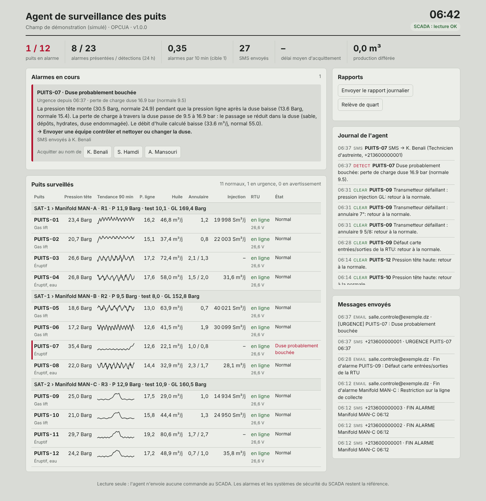
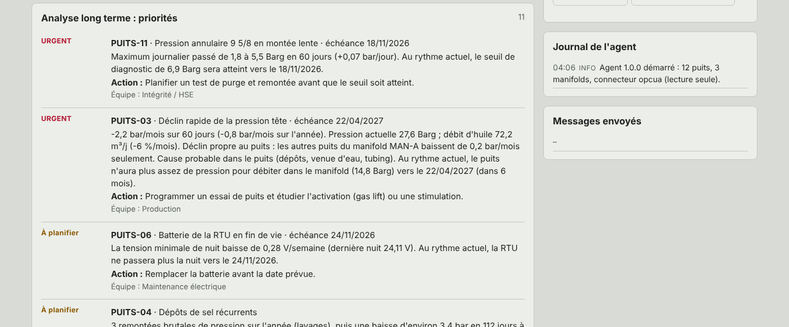
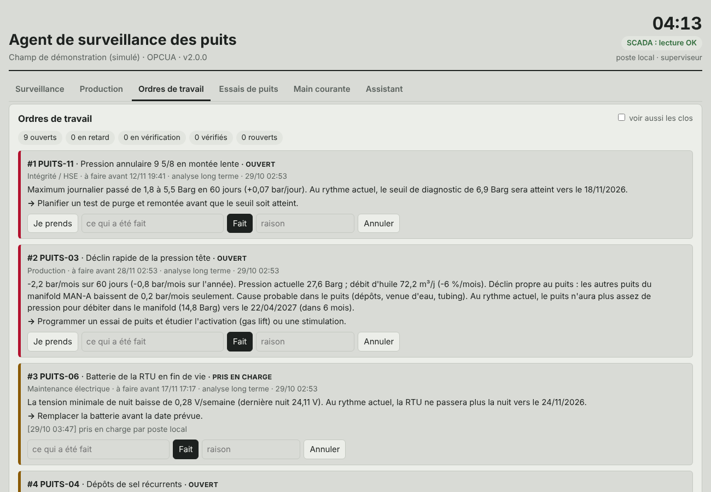
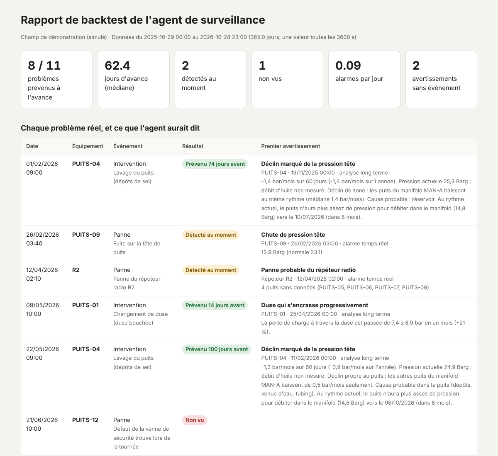

# Agent de surveillance des puits

*[English version](README.md)*

Un agent en lecture seule qui surveille des puits pétroliers jour et nuit à partir des données du SCADA. Il détecte les anomalies, trouve la cause probable, prévient l'astreinte par SMS, escalade quand personne ne répond, annonce les problèmes lents des semaines à l'avance, et fait le travail de bureau autour : main courante, rapport de production et de production différée, ordres de travail vérifiés dans les données, planning des essais de puits, relève de quart.

Il s'installe sur un PC ou un serveur du site, se connecte au SCADA en **OPC UA** ou en **Modbus TCP** avec un compte en lecture seule, et n'envoie jamais aucune commande aux équipements.



## Ce qu'il fait

- **Lit le SCADA chaque minute**, avec les mesures d'un écran puits typique : pression et température tête, pression ligne après la duse, pression d'arrivée au manifold, annulaires 7" et 9 5/8, débit d'huile calculé, débit, consigne et position de vanne gas lift, eau de dessalage, batterie et panneau solaire de la RTU, température du coffret, cartes E/S, vanne de sécurité, feu, contacts anti-intrusion, commandes à distance, puits en essai ; et pour chaque manifold les pressions des collecteurs production, test et gas lift.
- **Connaît les deux réseaux du champ** : les conduites (zone → satellite → manifold → puits) et la radio (RTU → répéteur → SCADA), qui ne regroupent pas toujours les mêmes puits.
- **Apprend les valeurs normales** de chaque puits, ou utilise celles fixées par l'ingénieur production, ou la consigne gas lift. Les valeurs normales suivent le déclin lent.
- **Détecte 24 types de problèmes**, dont la duse qui se bouche et la restriction de ligne (distinguées par la perte de charge à travers la duse et le long de la ligne), le gas lift sous la consigne vanne ouverte, la pression annulaire au-dessus du seuil API RP 90, les défauts de carte E/S et de transmetteurs, le panneau ou régulateur solaire en défaut des heures avant que la batterie soit vide, les contacts anti-intrusion, les problèmes de répéteur, de réseau gas lift, de manifold et de station satellite, et la perte de la liaison SCADA elle-même.
- **Une cause, une alarme.** Quatre puits muets en même temps donnent un seul SMS « répéteur en panne ». Un défaut de carte E/S et les trois transmetteurs qu'il fait lire négatif donnent une seule alarme. Deux manifolds qui montent ensemble donnent une seule alarme « station satellite » (suppression par conception, ISA-18.2).
- **Sait ce qui est normal** : une vanne de sécurité fermée juste après une commande à distance, un puits en essai ou qui redémarre après une fermeture ne réveillent personne.
- **Escalade par SMS** sur la liste d'astreinte (10 min par défaut) jusqu'à ce que quelqu'un réponde **OK** par SMS ou acquitte sur le tableau de bord. Un feu prévient tout le monde en même temps.
- **E-mails** pour chaque urgence et chaque fin d'alarme, **rapport journalier** (qui prouve aussi que l'agent tourne) et **relève de quart**.
- **Indicateurs d'alarmes** comparés à EEMUA 191 : alarmes par 10 min, pics, inondations, délai d'acquittement.

### Analyse long terme : les mois et les années, pas seulement les minutes

Les alarmes attrapent ce qui casse cette nuit. Mais beaucoup de pertes s'installent lentement, sur des semaines, et personne ne les voit sur un écran qui montre les dernières heures. Chaque jour l'agent garde la moyenne, le minimum et le maximum de chaque signal ; chaque semaine il étudie cet historique et envoie au superviseur une **liste de priorités** : ce qui change, quand cela deviendra un problème, quoi faire et quelle équipe doit agir.

| Ce qu'il cherche | Comment | Action proposée | Équipe |
|---|---|---|---|
| Puits qui décline plus vite que d'habitude | pente de la pression tête sur 60 jours comparée à l'année et aux autres puits du manifold | essai de puits, gas lift ou stimulation, avec la date où le puits ne débitera plus dans le manifold | Production |
| Dépôts de sel | remontées brutales après chaque lavage, puis baisse lente | rapprocher les lavages, plus d'eau de dessalage | Production |
| Chute brutale sans opération enregistrée | plusieurs bar perdus en un jour, sans fermeture | essai de puits | Production |
| Duse qui s'use ou se bouche sur des semaines | tendance de la perte de charge à travers la duse | inspecter la duse | Production |
| Transmetteur qui dérive | la pression baisse mais la température reste stable | réétalonner avant de conclure à un déclin | Instrumentation |
| Pression annulaire qui monte | tendance du maximum journalier, date d'atteinte du seuil | test de purge et remontée avant cette date | Intégrité / HSE |
| Batterie de RTU en fin de vie | tension minimale de nuit qui baisse semaine après semaine | remplacer avant la date | Maintenance électrique |
| Panneau solaire sale ou en défaut | courant de charge maximal qui baisse | nettoyer ou vérifier le panneau | Maintenance électrique |
| RTU ou répéteur peu fiable | disponibilité sous 97 %, pertes de liaison répétées | contrôle radio, antenne, répéteur | Télécom |
| Alarmes à répétition | la même alarme revient sans cesse | chercher la cause, revoir le seuil | selon l'alarme |

Le rapport part au superviseur (`email.report_to`). Avec `analysis.dispatch_to_teams: true`, chaque équipe reçoit aussi sa propre liste ; par défaut c'est le superviseur qui décide. **L'agent propose, l'équipe décide** : ce sont des estimations à partir de tendances, à vérifier sur le terrain.



## Version 2 : le travail de bureau autour de la surveillance

Regarder l'écran n'est qu'une partie du travail. Autour, la salle de contrôle tient la main courante, tape le rapport de production chaque matin, relance les ordres de travail, planifie les essais de puits et passe la relève. La version 2 fait ce travail avec les opérateurs. La version 1 (surveillance et alarmes seulement) est conservée sur la [branche `v1`](https://github.com/Djaafar-ar/agent-surveillance-puits/tree/v1).

| Ce que l'opérateur faisait à la main | Ce que fait l'agent maintenant |
|---|---|
| Main courante papier | Main courante électronique, signée par chaque utilisateur. L'état du puits qui y est écrit (fermé, en essai, en intervention) est utilisé par les règles : un site sans signal de vanne n'a pas de fausse alarme sur un puits fermé |
| Après un lavage ou un changement de duse, l'ancienne alarme reste | Une intervention écrite dans la main courante fait réapprendre les valeurs normales du puits et ferme les alarmes qu'elle explique ; les tendances repartent de ce jour |
| Rapport de production tapé chaque matin | Heures en production, en essai, fermé et sans données, huile par puits, **production différée par cause** (la raison écrite dans la main courante), Pareto des causes sur 30 jours, export CSV, envoi chaque matin |
| Appeler les équipes et relancer au téléphone | **Ordres de travail** ouverts à partir des alarmes qui durent ou des constats long terme, envoyés à la bonne équipe, relancés en cas de retard. Quand l'équipe dit « fait », l'agent **vérifie dans les données** que le problème a disparu, sinon il rouvre l'ordre |
| Planifier les essais sur un cahier | Puits en retard, planning proposé (un séparateur de test par manifold, les puits en déclin d'abord), contrôle de chaque résultat par rapport au dernier essai validé avant qu'il devienne le débit de référence |
| Écrire la relève de quart | Écrite automatiquement à chaque changement de quart : ce qui reste ouvert, les puits hors production et pourquoi, ce qui s'est passé, essais et ordres de travail, production différée du quart |
| « Qu'est-ce qui s'est passé sur le puits 7 cette nuit ? » | L'**assistant** répond à partir des données de l'agent. Sans IA (règles), ou avec un modèle d'IA **installé sur le site** (Ollama) ; toute adresse hors du réseau du site est refusée : les données des puits ne sortent pas du site |
| Personne ne voit que le PC de surveillance s'est arrêté | Signal de vie et `python -m agent status` pour la supervision du site, alarmes et valeurs apprises conservées après un redémarrage (pas de second SMS), sauvegarde quotidienne de la base, alerte d'espace disque |

**L'agent propose et relance ; les personnes décident et font le travail.** Il n'écrit toujours jamais dans le SCADA. Chaque action sur le tableau de bord est faite par un utilisateur nommé : lecture seule, opérateur ou superviseur (`python -m agent add-user`).



## Le prouver sur vos propres données : le backtest

Avant de faire confiance à l'agent, un site peut lui faire rejouer un export de l'historien et comparer ce qu'il aurait dit avec ce qui s'est vraiment passé :

```bash
python -m agent backtest --config config/config.yaml --csv export.csv --events events.csv
```

* `export.csv` : une colonne horodatage, puis une colonne par signal (`PUITS-01.whp`, `MAN-A.p_man`...). Des moyennes horaires suffisent ; les signaux absents sont acceptés.
* `events.csv` : les vrais événements de la période : `datetime, equipment, type, description`, avec le type `fermeture`, `panne`, `intervention`, `réouverture` ou `essai`. Ils sont rejoués dans la main courante à l'heure où ils se sont produits, comme les opérateurs les auraient écrits.

Le rapport donne, pour chaque vrai problème, **combien de jours avant** l'agent a prévenu et ce qu'il a dit, les problèmes manqués, les avertissements qui n'ont été suivis de rien, et la charge d'alarmes. Rien n'est envoyé pendant un backtest.

Sur une année simulée avec 11 problèmes cachés (`python -m simulator.export`), l'agent en a annoncé 8 à l'avance (62 jours avant en médiane), en a vu 2 au moment où ils arrivaient (une fuite soudaine et une panne de répéteur, sans signe avant-coureur), et en a manqué 1 : un défaut de vanne de sécurité trouvé lors d'une tournée, invisible dans les données. **Ces chiffres viennent de données simulées. Le vrai test, c'est une année d'historique du site.**



## Sûreté par conception

1. **Lecture seule.** Uniquement des lectures OPC UA et les codes fonction Modbus de lecture (1 à 4). Le code ne contient aucun appel d'écriture, et un test échoue si quelqu'un en ajoute un.
2. **Ce sont les règles qui décident, pas un modèle de langage.** La détection est déterministe et vérifiable.
3. **Il ne remplace ni les alarmes du SCADA ni les systèmes de sécurité.** C'est un deuxième regard pour la nuit, et chaque message le rappelle.
4. **Les données restent sur le site** : base SQLite locale, SMS par modem GSM, aucun service cloud obligatoire.
5. **Le tableau de bord n'écoute que sur la machine locale**, sauf si un mot de passe est défini.

## Installation sur un site

Le guide pas à pas pour l'équipe du site est ici : **[docs/INSTALL.fr.md](docs/INSTALL.fr.md)**.

En résumé : copier le dossier sur le PC, lancer `install\install-windows.bat` en administrateur, renseigner `config\config.yaml` et `config\secrets.env`, vérifier les tags avec `python -m agent check`, tester SMS et e-mail, puis démarrer le service.

## Essayer sans SCADA

Le simulateur joue le rôle du SCADA : l'agent s'y connecte en OPC UA exactement comme sur un site, sans savoir quel incident est déclenché.

```bash
pip install -r requirements.txt
python -m simulator.history --config config/config.sim.yaml --days 365   # une année d'historique simulée
python -m simulator.sim_server --speed 30 --scenario demo --night   # terminal 1
python -m agent run --config config/config.sim.yaml                 # terminal 2
```

Tableau de bord : http://127.0.0.1:8080. Page de contrôle des incidents : http://127.0.0.1:8090. Sous Windows, `install\demo-windows.bat` fait tout. Le scénario enchaîne en 8 minutes environ une chute de pression, une panne de répéteur, une panne du réseau gas lift, une hausse de pression annulaire, un feu, une restriction de collecte, un défaut de carte E/S et une duse qui se bouche.

Sur ce scénario, l'agent présente **8 alarmes pour 24 détections brutes**, avec un pic de 1 alarme par 10 minutes au lieu de 5. Ces chiffres viennent d'une simulation, pas du terrain.

Une version de la démo qui tourne dans le navigateur, sans installation : **[djaafar-ar.github.io/agent-surveillance-puits](https://djaafar-ar.github.io/agent-surveillance-puits/)**.

## Tests

```bash
pip install -r requirements-dev.txt
python -m pytest tests          # moteur et bout en bout : 130 tests, environ 4 minutes
python tests/test_demo_page.py  # démo navigateur
```

## Limites

- Validé uniquement sur le simulateur et sur des données Modbus et CSV de synthèse. **Il n'a pas encore tourné sur un vrai SCADA.** L'étape suivante est un pilote en parallèle du système existant.
- Les seuils sont des valeurs de départ, à fixer avec les ingénieurs production de chaque site.
- Les chiffres de production sont des estimations si le puits n'a pas de débitmètre : ils utilisent le dernier essai validé, le débit appris ou le potentiel.
- L'assistant ne répond qu'à partir des données de l'agent ; avec un modèle d'IA local, les réponses restent à vérifier sur le tableau de bord.
- Ce n'est pas un système de sécurité et il n'est pas certifié.

## Références

EEMUA 191 et ISA-18.2 (gestion des alarmes), API RP 90 (pression annulaire, MAASP), modèle Purdue et IEC 62443 (cybersécurité industrielle), OPC UA (IEC 62541), Modbus.

## Auteur

**Djaafar Arbane**, master en intelligence artificielle (Université de M'Sila, 2026). Mémoire sur l'IA appliquée à la récupération assistée du pétrole par surfactants.

[GitHub](https://github.com/Djaafar-ar)

## Licence

MIT, voir [LICENSE](LICENSE).
