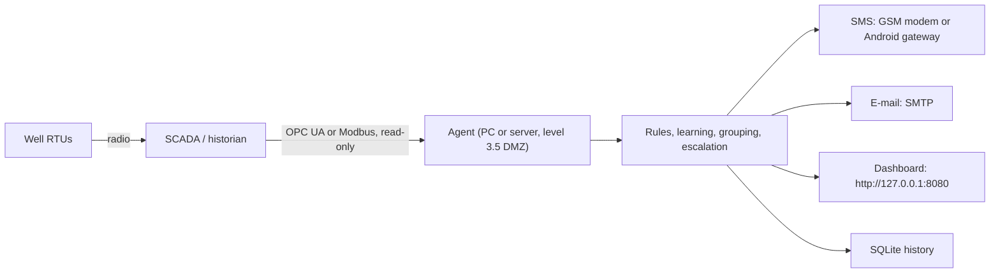

# Well Surveillance Agent

*[Version française](README.fr.md)*

A read-only agent that watches oil wells around the clock from the SCADA data. It detects anomalies, works out the probable root cause, pages the on-call engineer by SMS, escalates when nobody answers, and emails the reports.

It is installed on a PC or server on site, connects to the SCADA over **OPC UA** or **Modbus TCP** with a read-only account, and never sends a command to any equipment.


## What it does

- **Reads the SCADA every minute**, with the signals of a typical well screen: wellhead pressure and temperature, line pressure after the choke, arrival pressure at the manifold, 7" and 9 5/8 annulus, calculated oil rate, gas lift rate, set-point and valve position, desalting water, RTU battery and solar panel, cabinet temperature, I/O cards, safety valve, fire, anti-intrusion contacts, remote commands, well on test; plus production, test and gas lift header pressures of each manifold.
- **Knows the two networks of the field**: the pipes (zone → satellite station → manifold → well) and the radio (RTU → repeater → SCADA), which are not always the same groups.
- **Learns the normal values** of each well (rolling median while the well has no alarm), or uses values set by the production engineer, or the gas lift set-point. Normal values follow slow decline.
- **Detects 24 kinds of problems**, including choke plugging and flowline restriction (told apart from the pressure drop across the choke and along the line), gas lift below set-point with the valve open, annulus pressure above the API RP 90 diagnostic threshold, I/O card faults, failed transmitters, solar panel or regulator faults hours before the battery runs flat, intrusion contacts, repeater, gas lift network, manifold and satellite station problems, and loss of the SCADA link itself.
- **One cause, one alarm.** Four wells going silent at once give one "repeater down" SMS, not four. An I/O card fault and the three transmitters it makes read negative give one alarm, not four. Two manifolds rising together give one "satellite station" alarm (ISA-18.2 designed suppression).
- **Knows what is normal on purpose**: a safety valve closed right after a remote command, a well on test or restarting after a shut-in do not wake anyone up.
- **SMS escalation** along the on-call roster (10 min by default) until someone replies **OK** by SMS or acknowledges on the dashboard. Fire pages everyone at once.
- **E-mails** for every emergency and end of alarm, a **daily report** (which also proves the agent is alive) and a **shift handover**.
- **Alarm KPIs** against EEMUA 191: alarms per 10 min, peaks, floods, time to acknowledge.

## Safety by design

1. **Read-only.** Only OPC UA reads and Modbus read function codes (1–4). The code contains no write call, and a test fails if one is ever added.
2. **The rules decide, not a language model.** Detection is deterministic and auditable: thresholds, rates of change, topology, time windows.
3. **It does not replace the SCADA alarms or the safety systems.** It is a second pair of eyes for the night, and says so in every message.
4. **Data stays on site**: local SQLite database, SMS through a GSM modem, no cloud service required.
5. **The dashboard listens only on the local machine** unless a password is set.

## Architecture



| Folder | Contents |
|---|---|
| `agent/` | The agent: connectors (`opcua`, `modbus`, `csvreplay`), rule engine, notifications, reports, dashboard |
| `config/` | `config.example.yaml` (OPC UA site), `config.modbus.example.yaml`, `config.sim.yaml` (demo), `secrets.env.example` |
| `install/` | Windows installer and service, Linux systemd unit, demo launchers |
| `simulator/` | **Demonstration only**: an OPC UA server that simulates a 12-well field, with an incident control page |
| `tests/` | Engine, end-to-end (OPC UA, Modbus, CSV, dashboard), browser demo |
| `index.html` | Browser-only version of the demo, for the online page |

## Install on a site (Windows)

Requirements: Windows 10/11 or Server, [Python 3.10+](https://www.python.org/downloads/) ("Add python.exe to PATH"), network access to the SCADA's OPC UA server (or the RTUs' Modbus), a GSM USB modem or an Android phone for SMS, an SMTP account for e-mail.

1. Copy the folder to the PC, for example `C:\agent-surveillance-puits`.
2. Right-click `install\install-windows.bat` > **Run as administrator**. It creates the Python environment, installs the dependencies and registers the agent as a task that starts with Windows and restarts it if it stops.
3. Edit `config\config.yaml`: SCADA address, tag addresses, wells, on-call phones, e-mail addresses.
4. Put the passwords in `config\secrets.env` (never in the YAML).
5. Commissioning:
   ```bat
   .venv\Scripts\python -m agent browse --config config\config.yaml     :: find tag addresses on the OPC UA server
   .venv\Scripts\python -m agent check  --config config\config.yaml     :: read every tag once: value, quality, age
   .venv\Scripts\python -m agent test-sms   --config config\config.yaml --to +213XXXXXXXXX
   .venv\Scripts\python -m agent test-email --config config\config.yaml --to you@site.dz
   ```
6. Start: `schtasks /run /tn AgentSurveillancePuits`, then open http://127.0.0.1:8080.

Step-by-step guide for the site team, in French: [docs/INSTALL.fr.md](docs/INSTALL.fr.md). Linux: `install/agent.service`.

### Connecting to your SCADA

- **OPC UA** (most modern SCADA and historians): set `connector.url`, a read-only account, and the address pattern of each signal (`well_tags`, with `{id}` replaced by the well name). Per-well overrides are possible. A signed and encrypted session (`Basic256Sha256`) is supported.
- **Modbus TCP**: each signal is a register or a discrete input with its type, scale and word order. See `config/config.modbus.example.yaml`.
- **CSV replay**: replays a historian export through the same rules, to tune thresholds on real past events before going live.

A lost RTU is detected from the OPC UA `StatusCode` and `SourceTimestamp`, from the SCADA communication flag if there is one, or from failed Modbus reads.

### SMS acknowledgement

The on-call engineer answers **OK** to the SMS. With a GSM modem, the agent reads the replies itself; with *SMS Gateway for Android*, point its `sms:received` webhook to `http://<agent>:8080/api/sms-in`. Only numbers in the roster can acknowledge, and only alarms they were paged for.

## Try it without a SCADA

The simulator plays the role of the SCADA: the agent connects to it over OPC UA exactly as on a site, and is not told which incident is triggered.

```bash
pip install -r requirements.txt
python -m simulator.sim_server --speed 30 --scenario demo --night   # terminal 1
python -m agent run --config config/config.sim.yaml                 # terminal 2
```

Open the dashboard at http://127.0.0.1:8080 and the incident control page at http://127.0.0.1:8090. On Windows, `install\demo-windows.bat` does all of this. The scripted scenario runs a pressure drop, a repeater failure, a gas lift network failure, an annulus pressure rise, a fire, a manifold restriction, an I/O card fault and a plugging choke in about 8 minutes.

On that scenario the agent presents **8 alarms for 24 raw detections**, with a peak of 1 alarm per 10 minutes instead of 5. These figures come from a simulation, not from field data.


A browser-only version of the demo, with no installation, is available online: **[djaafar-ar.github.io/agent-surveillance-puits](https://djaafar-ar.github.io/agent-surveillance-puits/)**.

## Tests

```bash
pip install -r requirements-dev.txt
python -m pytest tests          # engine and end-to-end: 98 tests, about 3 minutes
python tests/test_demo_page.py  # browser demo (needs: python -m playwright install chromium)
```

They check zero false alarms over 24 h of normal operation (several random seeds, including with the most sensitive thresholds), detection and grouping of every incident, escalation timing, SMS and dashboard acknowledgement, recovery after a shut-in, loss of the SCADA link, the OPC UA, Modbus and CSV connectors, the dashboard security, and that no connector can write.

## Limitations

- Validated only against the simulator and synthetic Modbus/CSV data. **It has not yet run on a real SCADA.** The next step is a pilot in parallel with the existing system.
- Thresholds are starting values, to be agreed with the production engineers of each site.
- Alarm state is kept in memory: after a restart, active alarms are detected and sent again.
- Not a safety system, not certified.

## Roadmap

1. 3-month pilot on 5 wells, read-only, in parallel with the current system; measure false and missed alarms.
2. Threshold tuning per well from the pilot data and CSV replays.
3. Long-term decline analysis on a full year of history (already computed from the daily averages after 21 days).
4. English interface for the online demo.

## References

EEMUA 191 and ISA-18.2 (alarm management), API RP 90 (annular casing pressure, MAASP), Purdue model and IEC 62443 (industrial cybersecurity), OPC UA (IEC 62541), Modbus.

## Author

**Djaafar Arbane**, MSc in Artificial Intelligence (Université de M'Sila, 2026). Master's thesis on AI applied to improved oil recovery with surfactants.

[GitHub](https://github.com/Djaafar-ar)

## License

MIT, see [LICENSE](LICENSE).
