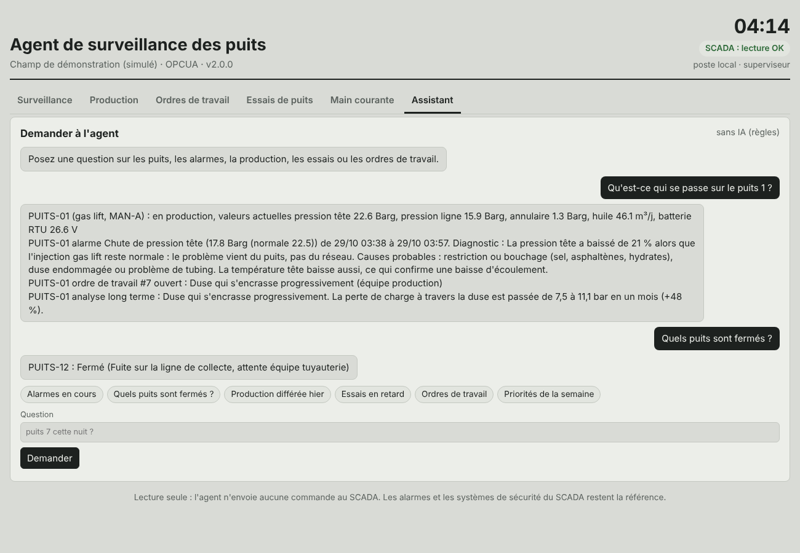
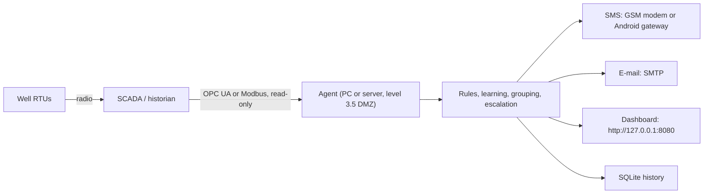
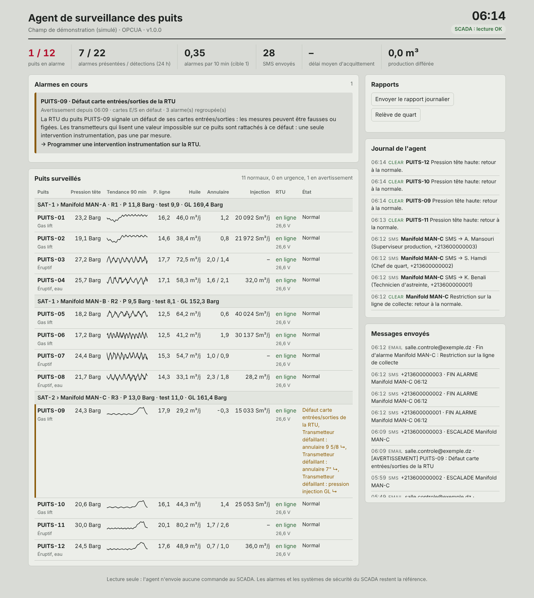
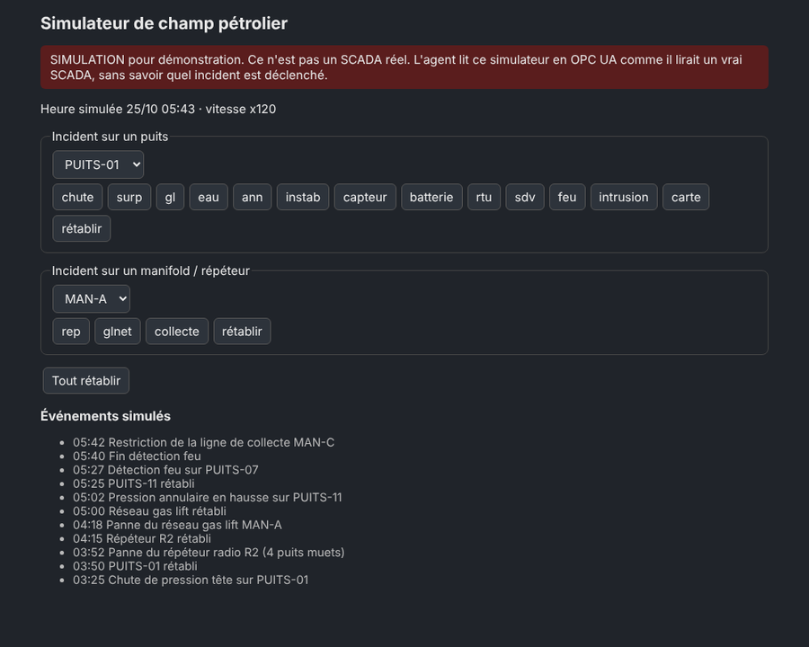

# Well Surveillance Agent

*[Version française](README.fr.md)*

A read-only agent that watches oil wells around the clock from the SCADA data. It detects anomalies, works out the probable root cause, pages the on-call engineer by SMS, escalates when nobody answers, predicts slow problems weeks ahead, and does the control-room paperwork around it: logbook, production and deferred production report, work orders checked in the data, well test planning, shift handover.

It is installed on a PC or server on site, connects to the SCADA over **OPC UA** or **Modbus TCP** with a read-only account, and never sends a command to any equipment.


## What it does

- **Reads the SCADA every minute**, with the signals of a typical well screen: wellhead pressure and temperature, line pressure after the choke, arrival pressure at the manifold, 7" and 9 5/8 annulus, calculated oil rate, gas lift rate, set-point and valve position, desalting water, RTU battery and solar panel, cabinet temperature, I/O cards, safety valve, fire, anti-intrusion contacts, remote commands, well on test; plus production, test and gas lift header pressures of each manifold.
- **Knows the two networks of the field**: the pipes (zone → satellite station → manifold → well) and the radio (RTU → repeater → SCADA), which are not always the same groups.
- **Learns the normal values** of each well (rolling median while the well has no alarm), or uses values set by the production engineer, or the gas lift set-point. Normal values follow slow decline.
- **Detects 24 kinds of problems**, including choke plugging and flowline restriction (told apart from the pressure drop across the choke and along the line), gas lift below set-point with the valve open, annulus pressure above the API RP 90 diagnostic threshold, I/O card faults, failed transmitters, solar panel or regulator faults hours before the battery runs flat, intrusion contacts, repeater, gas lift network, manifold and satellite station problems, and loss of the SCADA link itself.
- **One cause, one alarm.** Four wells going silent at once give one "repeater down" SMS, not four. An I/O card fault and the three transmitters it makes read negative give one alarm, not four. Two manifolds rising together give one "satellite station" alarm (ISA-18.2 designed suppression).
- **Knows what is normal on purpose**: a safety valve closed right after a remote command, a well on test or restarting after a shut-in do not wake anyone up.
- **SMS escalation** along the on-call roster (10 min by default) until someone replies **OK** by SMS or acknowledges on the dashboard. Fire pages everyone at once.
- **E-mails** for every emergency and end of alarm, a **daily report** (which also proves the agent is alive) and a **shift handover**.
- **Alarm KPIs** against EEMUA 191: alarms per 10 min, peaks, floods, time to acknowledge.

### Long-term analysis: months and years, not just minutes

The alarms catch what breaks tonight. Most losses build up slowly, over weeks, and nobody sees them on a screen that shows the last few hours. Every day the agent saves the mean, minimum and maximum of each signal, and every week it studies that history and sends the supervisor a **priority list**: what is changing, when it will become a problem, what to do, and which team should do it.

| What it looks for | How | Proposed action | Team |
|---|---|---|---|
| Well declining faster than usual | wellhead pressure slope over 60 days vs the year, compared with the other wells of the same manifold | well test, gas lift or stimulation, with the date the well stops flowing into the manifold | Production |
| Salt deposits | sudden pressure jumps after each wash, then a slow fall | wash more often, more desalting water | Production |
| Sudden step with no operation logged | pressure drop of several bar in a day, no shut-in recorded | well test | Production |
| Choke wearing or plugging over weeks | trend of the pressure drop across the choke | inspect the choke | Production |
| Transmitter drifting | pressure falls but temperature stays flat | recalibrate before concluding to a decline | Instrumentation |
| Annulus pressure building up | trend of the daily maximum, date it reaches the threshold | bleed-down / build-up test before that date | Integrity / HSE |
| RTU battery ageing | night minimum voltage falling week after week | replace the battery before the date | Electrical maintenance |
| Solar panel dirty or failing | daily peak charging current falling | clean or check the panel | Electrical maintenance |
| Unreliable RTU or repeater | availability below 97 %, repeated link losses | radio survey, antenna, repeater | Telecom |
| Bad actors | same alarm coming back again and again | find the root cause, review the threshold | per alarm |

The report goes to the supervisor (`email.report_to`). With `analysis.dispatch_to_teams: true` each team also receives its own list; by default the supervisor decides who acts. **The agent proposes, the team decides**: these are estimates from trends, to be checked on site.


## Version 2: the office work around the surveillance

Watching the screen is only part of the job. Around it, the control room writes the logbook, types the production report every morning, chases work orders, plans well tests and hands over to the next shift. Version 2 does that work with the operators. Version 1 (surveillance and alarms only) is kept on the [`v1` branch](https://github.com/Djaafar-ar/agent-surveillance-puits/tree/v1).

| What the operator did by hand | What the agent does now |
|---|---|
| Paper logbook (main courante) | Electronic logbook, signed by each user. The well status written there (shut in, on test, under intervention) is used by the rules, so a site without a valve signal still gets no false alarm on a shut-in well |
| After a wash or a choke change, the old alarm stays on | An intervention written in the logbook makes the agent relearn the well's normal values and close the alarms it explains; trends restart from that day |
| Daily production report typed every morning | Hours producing, on test, shut in and without data, oil per well, **deferred production by cause** (the reason written in the logbook), 30-day Pareto of causes, CSV export, e-mailed every morning |
| Calling teams and following up by phone | **Work orders** opened from alarms that last or from long-term findings, sent to the right team, reminded when late. When the team says "done", the agent **checks in the data** that the problem is gone, and reopens the order if it is not |
| Planning well tests in a notebook | Overdue wells, a proposed plan (one test separator per manifold, wells with a declining trend first), and a check of each result against the last validated test before it becomes the reference rate |
| Writing the shift handover | Written automatically at each shift change: what is still open, wells not producing and why, what happened, tests and work orders, deferred production of the shift |
| "What happened on well 7 last night?" | The **assistant** answers from the agent's data. Without AI (rules), or with an AI model **running on the site** (Ollama); any address outside the site network is refused, so well data never leaves the site |
| Nobody notices when the monitoring PC stops | Heartbeat and `python -m agent status` for the site's monitoring, alarms and learned values kept across restarts (no second SMS), daily database backup, disk-space warning |

**The agent proposes and follows up; people decide and do the work.** It still never writes to the SCADA. Every action on the dashboard is done by a named user: viewer, operator or supervisor (`python -m agent add-user`).




## Prove it on your own data: the backtest

Before trusting the agent, a site can replay a historian export through it and compare what it would have said with what really happened:

```bash
python -m agent backtest --config config/config.yaml --csv export.csv --events events.csv
```

* `export.csv`: one timestamp column, then one column per signal (`PUITS-01.whp`, `MAN-A.p_man`...). Hourly averages are enough; missing signals are allowed.
* `events.csv`: the real events of the period: `datetime, equipment, type, description`, with type `shut_in`, `failure`, `intervention`, `reopen` or `test`. It is replayed into the logbook at the time each event happened, as the operators would have written it.

The report lists every real problem with **how many days before** the agent warned, what it said, the problems it missed, the warnings that were followed by nothing, and the alarm load. Nothing is sent during a backtest.

On a simulated year with 11 planted problems (`python -m simulator.export`), the agent warned ahead of 8 (median 62 days before), saw 2 as they happened (a sudden leak and a repeater failure, which have no warning signs), and missed 1: a safety valve defect found on a site round, which is not visible in the data. **These figures come from simulated data. The real test is a year of the site's own history.**


## Safety by design

1. **Read-only.** Only OPC UA reads and Modbus read function codes (1–4). The code contains no write call, and a test fails if one is ever added.
2. **The rules decide, not a language model.** Detection is deterministic and auditable: thresholds, rates of change, topology, time windows.
3. **It does not replace the SCADA alarms or the safety systems.** It is a second pair of eyes for the night, and says so in every message.
4. **Data stays on site**: local SQLite database, SMS through a GSM modem, no cloud service required.
5. **The dashboard listens only on the local machine** unless a password is set.

## Architecture



| Folder | Contents |
|---|---|
| `agent/` | The agent: connectors (`opcua`, `modbus`, `csvreplay`), rule engine, long-term analysis, notifications, reports, dashboard |
| `agent/` (v2) | `logbook`, `production`, `workorders`, `welltests`, `assistant`, `users`, `upkeep`, `backtest` |
| `config/` | `config.example.yaml` (OPC UA site), `config.modbus.example.yaml`, `config.sim.yaml` (demo), `secrets.env.example` |
| `install/` | Windows installer and service, Linux systemd unit, demo launchers |
| `simulator/` | **Demonstration only**: an OPC UA server that simulates a 12-well field, with an incident control page; a simulated year of history (`history`) and of historian export with its event log (`export`) |
| `tests/` | Engine, end-to-end (OPC UA, Modbus, CSV, dashboard), browser demo |
| `index.html` | Browser-only version of the demo, for the online page |

## Install on a site (Windows)

Requirements: Windows 10/11 or Server, [Python 3.10+](https://www.python.org/downloads/) ("Add python.exe to PATH"), network access to the SCADA's OPC UA server (or the RTUs' Modbus), a GSM USB modem or an Android phone for SMS, an SMTP account for e-mail.

1. Copy the folder to the PC, for example `C:\agent-surveillance-puits`.
2. Right-click `install\install-windows.bat` > **Run as administrator**. It creates the Python environment, installs the dependencies and registers the agent as a task that starts with Windows and restarts it if it stops.
3. Edit `config\config.yaml`: SCADA address, tag addresses, wells, on-call phones, e-mail addresses.
4. Put the passwords in `config\secrets.env` (never in the YAML).
5. Commissioning:
   ```bat
   .venv\Scripts\python -m agent browse --config config\config.yaml     :: find tag addresses on the OPC UA server
   .venv\Scripts\python -m agent check  --config config\config.yaml     :: read every tag once: value, quality, age
   .venv\Scripts\python -m agent test-sms   --config config\config.yaml --to +213XXXXXXXXX
   .venv\Scripts\python -m agent test-email --config config\config.yaml --to you@site.dz
   ```
6. Start: `schtasks /run /tn AgentSurveillancePuits`, then open http://127.0.0.1:8080.

Step-by-step guide for the site team, in French: [docs/INSTALL.fr.md](docs/INSTALL.fr.md). Linux: `install/agent.service`.

### Connecting to your SCADA

- **OPC UA** (most modern SCADA and historians): set `connector.url`, a read-only account, and the address pattern of each signal (`well_tags`, with `{id}` replaced by the well name). Per-well overrides are possible. A signed and encrypted session (`Basic256Sha256`) is supported.
- **Modbus TCP**: each signal is a register or a discrete input with its type, scale and word order. See `config/config.modbus.example.yaml`.
- **CSV replay**: replays a historian export through the same rules, to tune thresholds on real past events before going live.

A lost RTU is detected from the OPC UA `StatusCode` and `SourceTimestamp`, from the SCADA communication flag if there is one, or from failed Modbus reads.

### SMS acknowledgement

The on-call engineer answers **OK** to the SMS. With a GSM modem, the agent reads the replies itself; with *SMS Gateway for Android*, point its `sms:received` webhook to `http://<agent>:8080/api/sms-in`. Only numbers in the roster can acknowledge, and only alarms they were paged for.

## Try it without a SCADA

The simulator plays the role of the SCADA: the agent connects to it over OPC UA exactly as on a site, and is not told which incident is triggered.

```bash
pip install -r requirements.txt
python -m simulator.history --config config/config.sim.yaml --days 365   # a simulated year of history
python -m simulator.sim_server --speed 30 --scenario demo --night   # terminal 1
python -m agent run --config config/config.sim.yaml                 # terminal 2
```

Open the dashboard at http://127.0.0.1:8080 and the incident control page at http://127.0.0.1:8090. On Windows, `install\demo-windows.bat` does all of this. The scripted scenario runs a pressure drop, a repeater failure, a gas lift network failure, an annulus pressure rise, a fire, a manifold restriction, an I/O card fault and a plugging choke in about 8 minutes.

On that scenario the agent presents **8 alarms for 24 raw detections**, with a peak of 1 alarm per 10 minutes instead of 5. These figures come from a simulation, not from field data.





A browser-only version of the demo, with no installation, is available online: **[djaafar-ar.github.io/agent-surveillance-puits](https://djaafar-ar.github.io/agent-surveillance-puits/)**.

## Tests

```bash
pip install -r requirements-dev.txt
python -m pytest tests          # engine and end-to-end: 130 tests, about 4 minutes
python tests/test_demo_page.py  # browser demo (needs: python -m playwright install chromium)
```

They check that the long-term analysis finds every problem planted in a simulated year (and nothing on the healthy wells), zero false alarms over 24 h of normal operation (several random seeds, including with the most sensitive thresholds), detection and grouping of every incident, escalation timing, SMS and dashboard acknowledgement, recovery after a shut-in, loss of the SCADA link, the OPC UA, Modbus and CSV connectors, the dashboard security, and that no connector can write.

## Limitations

- Validated only against the simulator and synthetic Modbus/CSV data. **It has not yet run on a real SCADA.** The next step is a pilot in parallel with the existing system.
- Thresholds are starting values, to be agreed with the production engineers of each site.
- Production figures are estimates unless the well has a flow meter: they use the last validated test, the learned rate or the potential.
- The assistant only answers from the agent's data; with a local AI model, answers must still be checked against the dashboard.
- Not a safety system, not certified.

## Roadmap

1. Backtest on a real year of the site's historian export and event log: the proof that decides the rest.
2. 3-month pilot on 5 wells, read-only, in parallel with the current system; measure false and missed alarms.
3. Threshold tuning per well from the backtest and the pilot.
4. Link with the site's maintenance system (work orders) if it has one, instead of e-mail.

## References

EEMUA 191 and ISA-18.2 (alarm management), API RP 90 (annular casing pressure, MAASP), Purdue model and IEC 62443 (industrial cybersecurity), OPC UA (IEC 62541), Modbus.

## Author

**Djaafar Arbane**, MSc in Artificial Intelligence (Université de M'Sila, 2026). Master's thesis on AI applied to improved oil recovery with surfactants.

[GitHub](https://github.com/Djaafar-ar)

## License

MIT, see [LICENSE](LICENSE).
